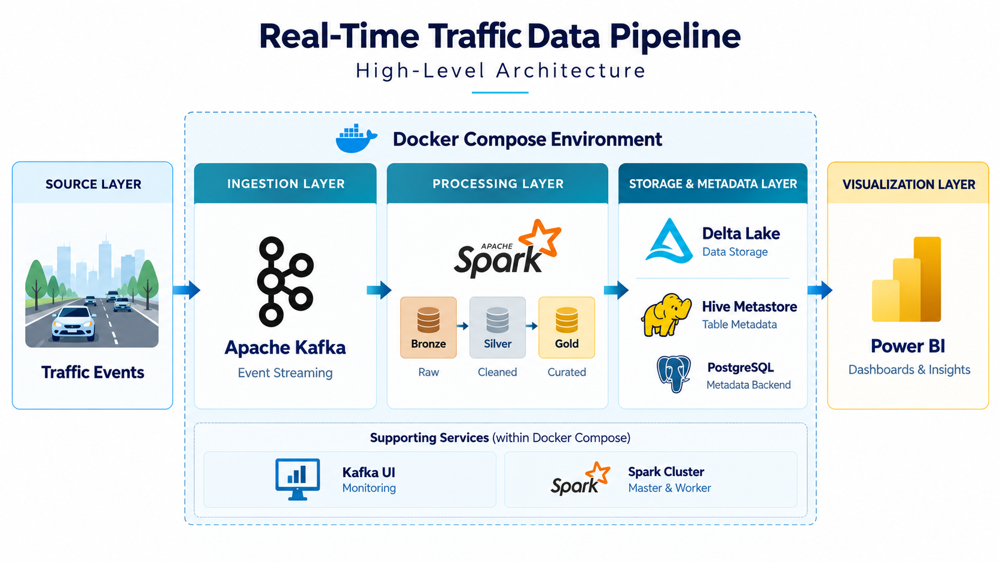

# Real-Time Traffic Data Pipeline

An end-to-end streaming data pipeline that transforms traffic events into analytics-ready datasets and Power BI dashboards using **Apache Kafka, PySpark, Delta Lake, and Docker**.

## Architecture

## Data Processing

- **Bronze:** ingest events from Kafka, parse incoming messages, and preserve raw payloads.
- **Silver:** apply data quality checks, type conversion, event-time watermarking, deduplication, and enrichment.
- **Gold:** build dimensional models and analytical datasets for reporting.

## Key Features

- Streaming ingestion and processing.
- Validation of missing values, invalid speeds, and timestamps.
- Event-time processing with watermarking.
- Deduplication using vehicle ID and event timestamp.
- Delta Lake storage with streaming checkpoints.
- Containerized infrastructure using Docker Compose.
- Kafka UI and Spark interfaces for monitoring.
- Power BI dashboards for traffic analysis.

## Technology Stack

**Python · Apache Kafka · Apache Spark · Delta Lake · Hive Metastore · PostgreSQL · Docker Compose · Power BI**

## Analytics & Reporting

Power BI dashboards present traffic insights, including:

- Vehicle speed trends.
- Congestion levels.
- Traffic patterns across roads and city zones.
- Peak-hour analysis.

## Author

[**Abdelrhman Desouky**](https://github.com/Abdelrhman-Desouky)
